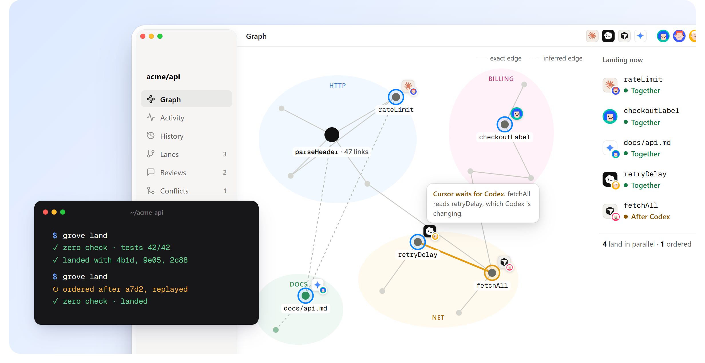
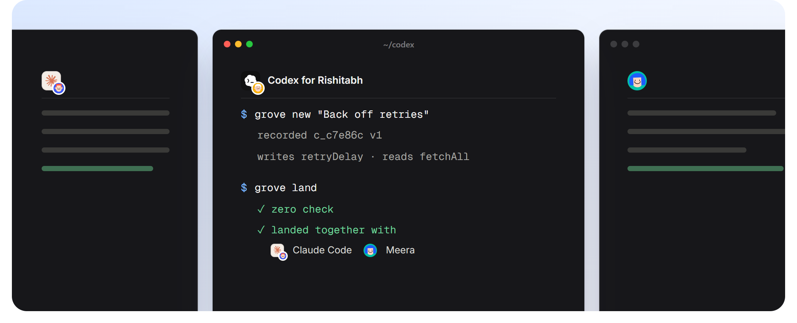
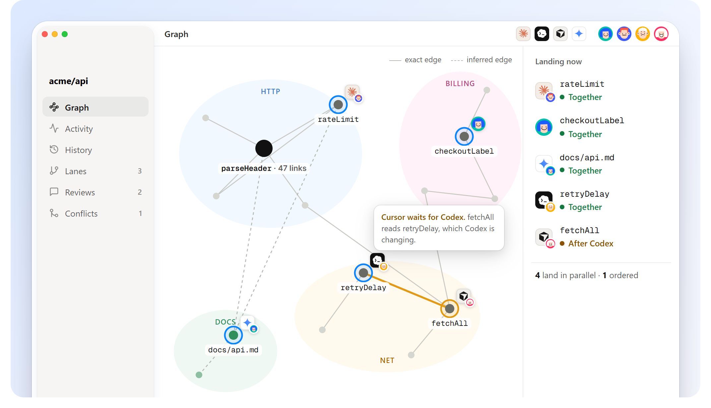
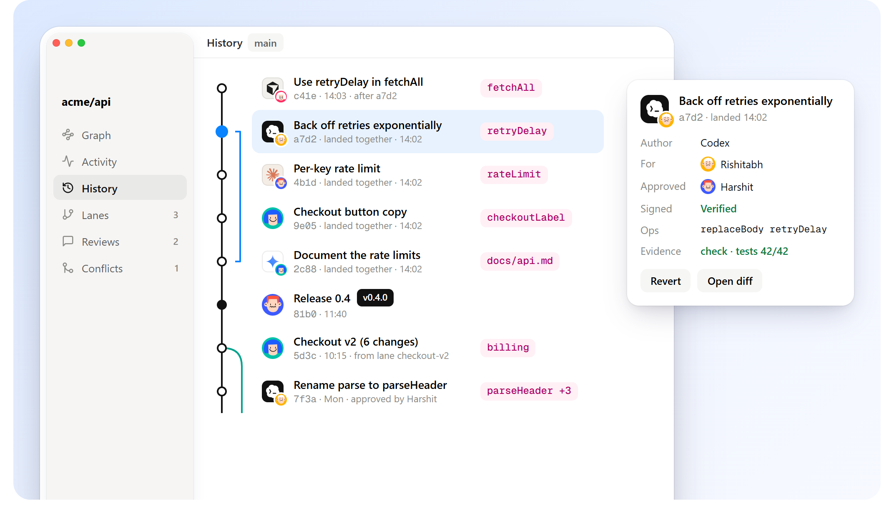
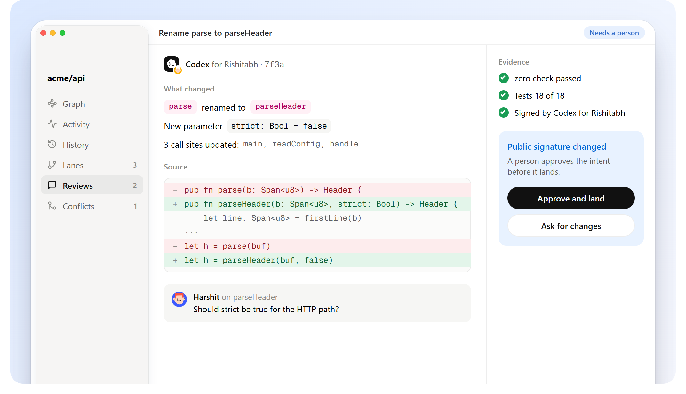
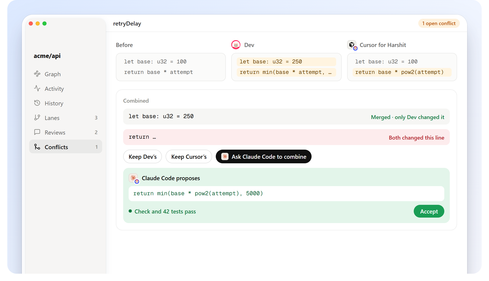
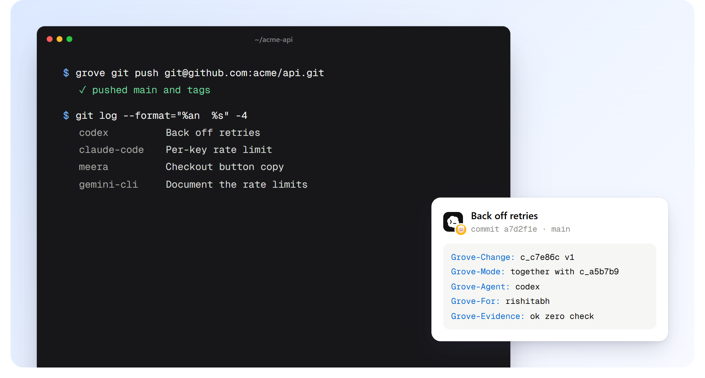

<p align="center">
  
</p>

<h1 align="center">Grove</h1>

<p align="center"><b>Source control for people and agents, with one graph underneath.</b></p>

<p align="center">
  <a href="https://github.com/AgentsORG/grove/releases/latest"></a>
  <a href="https://github.com/AgentsORG/grove/actions/workflows/ci.yml"></a>
  <a href="LICENSE"></a>
</p>

<p align="center">
  <a href="docs/install.md">Install</a> ·
  <a href="docs/quickstart.md">Quick start</a> ·
  <a href="docs/concepts.md">Concepts</a> ·
  <a href="docs/commands.md">Commands</a> ·
  <a href="docs/git-parity.md">Git parity</a> ·
  Built in the open by <a href="https://agents.org.in">Agents</a>
</p>

---

## Install

**macOS and Linux**

```bash
curl -fsSL https://raw.githubusercontent.com/AgentsORG/grove/main/install.sh | sh
```

**Windows (PowerShell)**

```powershell
irm https://raw.githubusercontent.com/AgentsORG/grove/main/install.ps1 | iex
```

**For agents** (Claude Code, Codex, Cursor, Copilot, Gemini CLI, and others that read skills)

```bash
npx skills add AgentsORG/grove
```

Prebuilt for x86_64 and arm64 on all three systems, checksummed. Or from source: `cargo install --git https://github.com/AgentsORG/grove grove-cli`. More in [docs/install.md](docs/install.md).

---

## Why Grove

Agents now write code in parallel, many at a time. Git stores text and compares lines, so it calls two edits a conflict when they sit near each other, even when they change different things. And it can't tell you which agent did what, for whom, or why. Grove keeps everything git gives you and changes what a change *is*:

- **The program graph is the record.** Code is split into declarations, each with a stable id and a SHA-256 content address. The same code builds the same graph on every machine. Files and git commits are views of it.
- **A change knows what it touches:** its edits, its intent, who made it, who it was for, and what it writes and reads.
- **Separate work lands together. Dependent work is ordered after.** Edits to different lines of one function merge. Only the same lines set differently are a conflict, and it's saved for anyone to pick up.
- **Renames carry meaning.** A rename reaches call sites someone wrote after it.
- **Nothing lands unchecked.** Checks such as `zero check` run on the combined result first.
- **Everything can be undone,** including a land.
- **It's still git.** Push to GitHub or GitLab, pull commits back, import any git history with its original commit ids.

## Everyone in their own workspace



```bash
grove init --as harshit --zero
grove workspace add codex ../codex --as agent:codex --for rishitabh
grove workspace add meera ../meera --as meera

cd ../codex && grove new "Back off retries" && grove land
Landed c_c7e86c "Back off retries" (together with c_0d9501)
  ok   zero check
```

An agent always works *for* a person, and every change says so. [Working together →](docs/working-together.md)

## Parallel work, on the graph



Each ring is someone's change. People are round; agents are square and wear the face of the person they work for. Rings that don't touch land together. A shared edge orders one after the other. [Concepts →](docs/concepts.md)

## History you can ask questions



```bash
grove why retryDelay           # who changed it, for whom, and why, through renames
grove revert c_c7e86c          # undo a change as a new change
grove lane new checkout-v2     # longer work beside main
grove bisect --run "zero test ."
grove undo                     # any operation
```

[History →](docs/history.md)

## Reviews read meaning, conflicts are rare





[Reviews and conflicts →](docs/review-and-conflicts.md)

## Git all the way down



```bash
grove git push git@github.com:you/acme-api.git   # one commit per landing, with Grove trailers
grove git pull git@github.com:you/acme-api.git   # bring in commits made on GitHub
grove git import ~/code/old-repo ./acme-api      # any git history, original commit ids kept
```

[Git →](docs/git.md) · Every git command and its Grove form: [git parity](docs/git-parity.md)

## Commands

| | |
|---|---|
| `init`, `workspace add`, `clone` | Start, or join |
| `status`, `diff`, `new`, `land`, `sync` | The everyday loop |
| `log`, `show`, `why`, `find`, `evolve`, `shortlog`, `graph`, `cat` | Read history |
| `undo`, `ops`, `restore`, `shelve`, `revert`, `pick` | Undo and move work |
| `lane`, `tag`, `bisect` | Branches, releases, finding what broke |
| `conflicts`, `resolve`, `verify` | Conflicts and integrity |
| `key`, `approve`, `config`, `note`, `who` | Signatures, review rules, notes, presence |
| `remote`, `fetch`, `pull`, `push` | Between Grove repositories and GroveHub |
| `git export\|push\|pull\|import\|pr` | Between Grove and git, including pull requests |

All of them: [docs/commands.md](docs/commands.md). `--as`, `--for` and `--json` work everywhere.

## Built around Zero

Grove understands [Zero](https://zerolang.ai), the programming language for agents, best: its programs are graphs already. Every other file is tracked too, byte for byte.

```bash
curl -fsSL https://zerolang.ai/install.sh | bash   # optional: for `grove init --zero`
```

## Contributing

Every 🔜 on the [parity list](docs/git-parity.md) is a real task. Start with [CONTRIBUTING.md](CONTRIBUTING.md). Agents are welcome contributors: say which agent did the work and who it was for, the way Grove records it.

## License

[Apache-2.0](LICENSE) © 2026 Agents.
