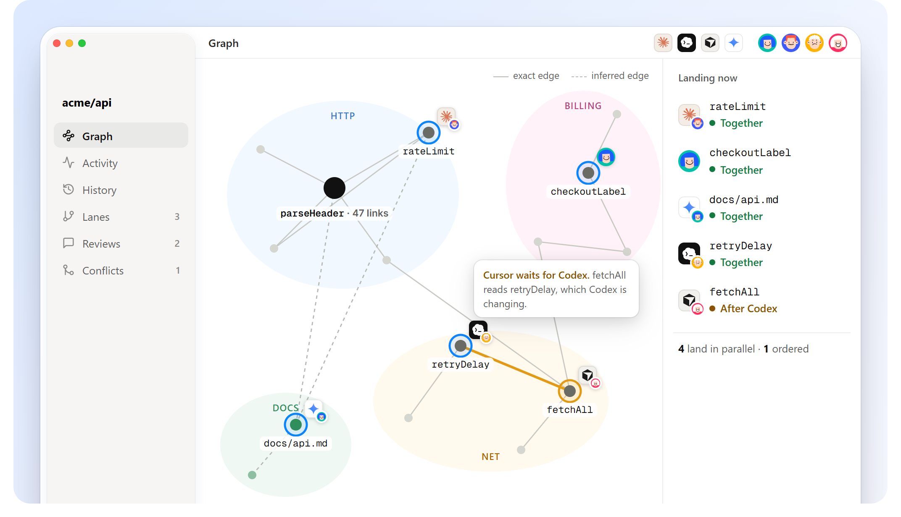

# Grove docs

Grove is source control for people and agents, with one graph underneath. Start here:

| | |
|---|---|
| [Install](install.md) | One line for macOS, Linux or Windows, and one for agents |
| [Quick start](quickstart.md) | A repository, two workspaces, two changes landed, in five minutes |
| [Concepts](concepts.md) | The program graph, changes, footprints, and how landing decides |
| [Working together](working-together.md) | Workspaces, agents acting for people, sync, conflicts |
| [History](history.md) | log, why, undo, revert, pick, lanes, tags, shelve, bisect |
| [Reviews and conflicts](review-and-conflicts.md) | Reading a change by meaning; when work really collides |
| [Git](git.md) | Export, push to GitHub or GitLab, import, pull: two-way |
| [Remotes and GroveHub](remotes.md) | Clone, fetch, pull and push between Grove repositories |
| [For agents](agents.md) | The skill, environment variables, `--json`, the rules |
| [Command reference](commands.md) | Every command and what it does |
| [Git parity](git-parity.md) | Every git command, and its Grove form |
| [Design](design.md) | How it works inside |
