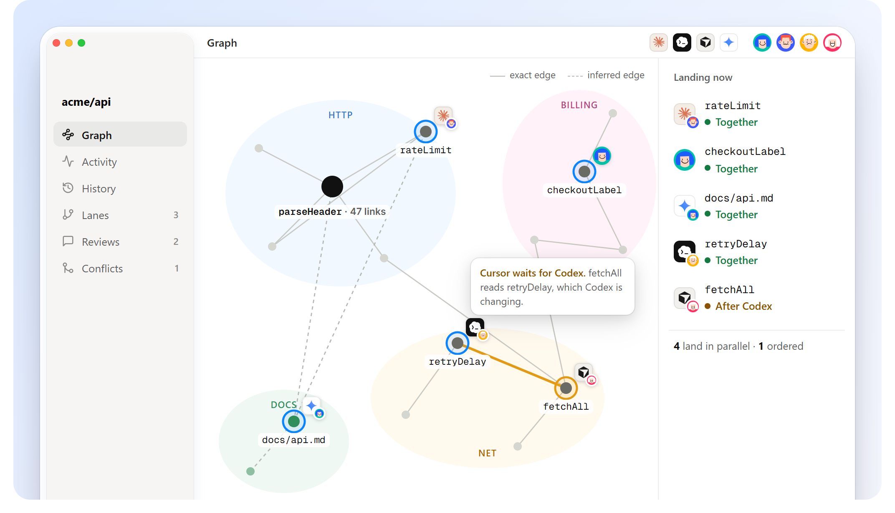

# Concepts

## The program graph is the record

Grove reads code as **declarations**: in Zero files, each function, constant, `use` line, test and type, with the comments above it. Every other file is one declaration of its own: text kept byte for byte, binary kept as bytes.

Each declaration has:

- a **stable id**. It comes from where the declaration lives and what it's called, never from the machine or the clock, so every machine builds the same graph. It survives edits and renames.
- a **content address**: the SHA-256 of its source.

**Edges** come from references. A call in Zero code is a *code* edge. When the `zero` compiler is installed, Grove asks Zero's own resolver which declaration each reference means, so a parameter that shares a function's name isn't mistaken for a call; without it, Grove matches names. A name written in backticks in a doc is a *mention* edge: inferred, and weaker. Edges are derived from content whenever they're needed, so they can never disagree with it.

Files, git commits and the app are views of this graph.

## A change knows what it touches

A **change** is:

| | |
|---|---|
| **ops** | add, replace, rename, delete, each aimed at a declaration's id and each expecting what it will find |
| **intent** | one line: what and why |
| **actor** | who made it; an agent always acts *for* a named person |
| **footprint** | what it **writes**, what its renames **rewrite**, and what it **reads** (one edge away) |
| **versions** | recording again makes a new version of the same change |

You don't write ops. Edit files as usual; `grove new` compares your workspace with where it started, declaration by declaration, and writes them. A rename is detected as one op that carries every call site with it.

## How landing decides

When a change lands, Grove looks at everything that reached main since the change began:

1. **Same declaration, different results**: a real conflict, unless the two edits touch different lines of it, in which case Grove merges them. A conflict is saved, never lost.
2. **Replay**: the ops apply to today's main. Renames that landed meanwhile are carried into the incoming edits, so they still land correctly.
3. **Order**: if anything that landed since touched what this change depends on, it lands *ordered after* it. Otherwise it lands *together* with it.
4. **Check**: the combined result is written to a scratch folder and every check runs there (`zero check`, your tests). If one fails, main doesn't move.
5. **Land**: main moves in one atomic step.

## Everything can be undone

Every command that changes Grove's state is in the **operation log**, with the state before and after. `grove undo` steps back, including over a land, a sync or a lane change. `grove ops` lists them.

## Lanes, tags, drafts, shelves

- A **lane** is a named line of work beside main (git's branch). Most agent work doesn't need one: small changes land on main directly, made safe by footprints.
- A **tag** names a landing: a release.
- A **draft** is a recorded change not yet landed.
- A **shelf** is unrecorded edits put aside (git's stash).

Next: [Working together](working-together.md).
