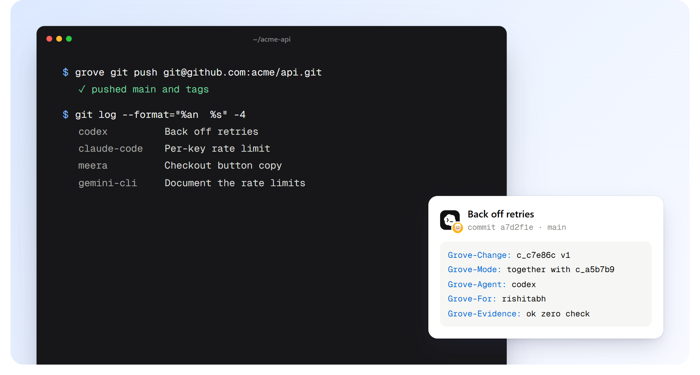

# Git



GitHub, GitLab, Bitbucket, CI systems, editors and code review tools all speak git. Grove speaks it too, both ways.

## Push

```bash
grove git push git@github.com:you/acme-api.git
```

Every landing becomes one git commit on `main`:

- the **author** is whoever made the change (`codex@agents.grove` for an agent, `meera@people.grove` for a person),
- the **message** is the intent,
- the **trailers** carry the rest: `Grove-Change`, `Grove-Mode` (direct, together, ordered), `Grove-Agent`, `Grove-For`, `Grove-Evidence`.

Tags are pushed as git tags. Undo in Grove moves git's `main` back on the next push (use `--force` when the remote already has the undone commit).

`grove git export` writes the same history to `.grove/git` without pushing, for any git tool to read.

## Pull

```bash
grove git pull git@github.com:you/acme-api.git
```

Brings in commits made on the git side, for example a pull request merged on GitHub:

- If Grove's main hasn't moved, they land directly and keep their commit ids.
- If it has, each commit is replayed on top like any change (ordered, checked) and exported as a **merge commit**, so the next `grove git push` fast-forwards instead of being refused.

## Import

```bash
grove git import ~/code/old-repo ~/code/acme-api
grove git import ~/code/old-repo ~/code/acme-api --last 200   # only recent history
```

Turns a git repository's first-parent history into Grove changes, keeping each commit's author, date and subject. When Grove reproduces a commit's tree exactly, the commit keeps its id, so importing and exporting again gives back the same history.

## What carries over

| | |
|---|---|
| Text files | Byte for byte |
| Binary files | Byte for byte |
| Authors, dates, messages | Yes |
| Tags | Yes |
| Merge commits | Pull merges are written as real merge commits; import follows first parents |
| Submodules, LFS pointers | Kept as files today; see [git parity](git-parity.md) |
