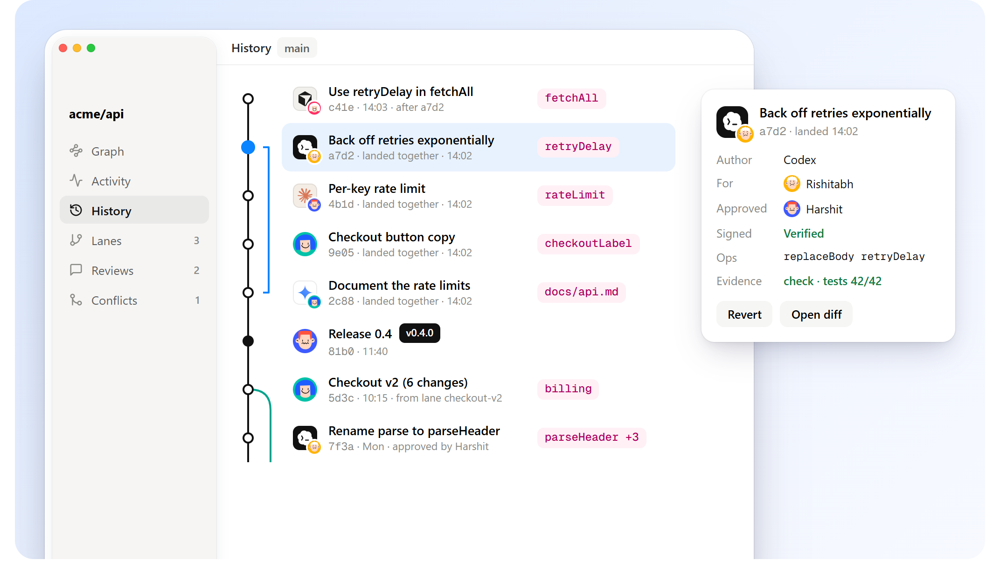

# History



## Reading it

```bash
grove log                    # main's landings: who, why, and how each landed
grove show c_c7e86c          # one change: actor, footprint, ops
grove why retryDelay         # who last changed it, for whom, and why
grove why retryDelay --all   # every change that touched it, through renames
grove find "retryDelay("     # lines on main
grove evolve c_c7e86c        # every version of a change
grove shortlog               # landed changes per person and agent
grove graph --dot | dot -Tsvg > graph.svg
```

## Undoing

| | |
|---|---|
| `grove undo` | Step back over the last operation: a land, a record, a sync, a lane switch |
| `grove ops` | The operation log |
| `grove restore [files]` | Throw away unrecorded edits |
| `grove revert c_...` | Undo a landed change as a new change, replayed and checked like any other |

## Moving work around

| | |
|---|---|
| `grove shelve [name]` / `grove unshelve [name]` | Put unrecorded edits aside, and bring them back later on top of a newer main |
| `grove pick c_...` | Apply a change from a lane, a shelf or an undone landing |
| `grove lane new\|use\|land\|list\|drop` | Named lines of work beside main |
| `grove tag v1.0.0` | Name a landing. Tags go to git as git tags |

## Finding what broke

```bash
grove bisect --run "zero test ." --good v0.1.0
```

Grove checks out landings in a scratch folder, halving the range until it finds the first one where the command fails, and tells you the change and who made it.
