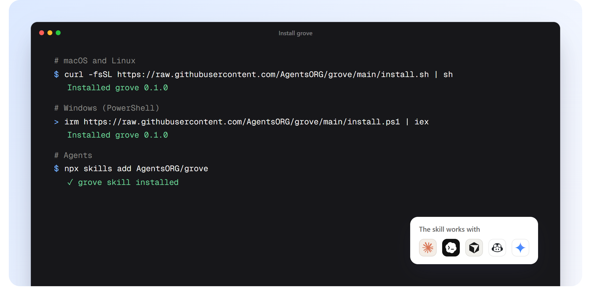

# Install



## macOS and Linux

```bash
curl -fsSL https://raw.githubusercontent.com/AgentsORG/grove/main/install.sh | sh
```

Installs `grove` into `~/.grove/bin`. Add it to your PATH if the installer says so:

```bash
export PATH="$PATH:$HOME/.grove/bin"
```

## Windows

In PowerShell:

```powershell
irm https://raw.githubusercontent.com/AgentsORG/grove/main/install.ps1 | iex
```

Installs `grove.exe` into `%USERPROFILE%\.grove\bin` and adds it to your user PATH (new terminals pick it up). In Git Bash, the macOS and Linux line works too.

## Agents

```bash
npx skills add AgentsORG/grove
```

Adds the Grove skill to Claude Code, Codex, Cursor, Copilot, Gemini CLI and other agents that read skills. The skill installs `grove` itself when it's missing, and teaches the agent the loop: its own workspace, `grove new`, `grove land`, and what to do when a land doesn't go through. See [For agents](agents.md).

## From source

Needs [Rust](https://rustup.rs) 1.80 or newer.

```bash
cargo install --git https://github.com/AgentsORG/grove grove-cli
```

## What gets installed

| Platform | Binary |
|---|---|
| macOS, Apple silicon | `grove-aarch64-apple-darwin` |
| macOS, Intel | `grove-x86_64-apple-darwin` |
| Linux, x86_64 (static) | `grove-x86_64-unknown-linux-musl` |
| Linux, arm64 (static) | `grove-aarch64-unknown-linux-musl` |
| Windows, x86_64 | `grove-x86_64-pc-windows-msvc` |
| Windows, arm64 | `grove-aarch64-pc-windows-msvc` |

Every download is checked against the SHA-256 published with the release.

## Settings

| Variable | Default | Does |
|---|---|---|
| `GROVE_VERSION` | latest | Install a specific release, like `v0.1.0` |
| `GROVE_INSTALL_DIR` | `~/.grove/bin` | Where the binary goes |
| `GROVE_NO_MODIFY_PATH` | unset | Windows: leave your PATH alone |

## Optional: Zero

Grove reads every text and binary file, and understands [Zero](https://zerolang.ai) code best. For `zero check` before every landing (`grove init --zero`), install Zero too:

```bash
curl -fsSL https://zerolang.ai/install.sh | bash
```

## Check it worked

```bash
grove --version
```
