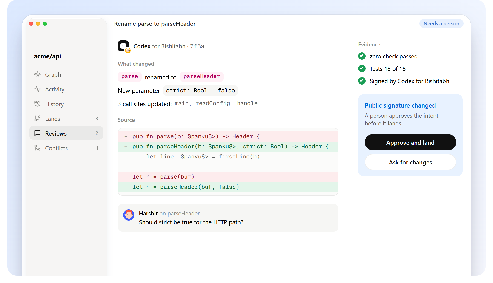
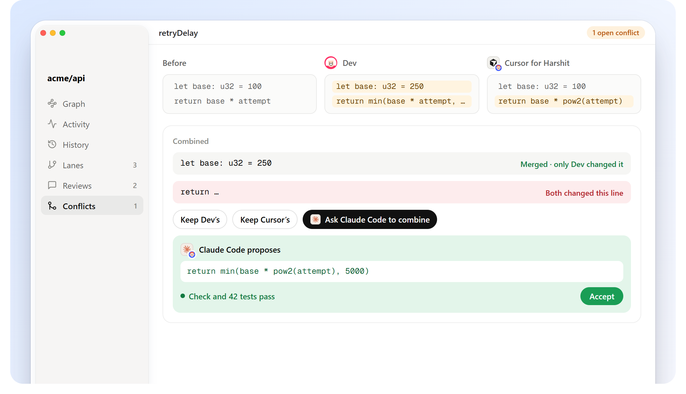

# Reviews and conflicts

## Read a change by meaning



`grove show` lists a change as what it did: renamed `parse` to `parseHeader`, changed `retryDelay`, added `clamp`. Because it knows which declarations it wrote and which it only read, you can see its reach without reading every line. `grove diff c_...` gives the text diff when you want it.

Evidence travels with every landing: which checks ran on the combined result, and whether they passed.

## When work really collides



Grove only stops a landing when two changes set **the same lines** of a declaration differently. Edits to different lines of the same function are merged. Identical edits aren't a conflict.

A conflict is saved, never lost:

```bash
grove conflicts                # open conflicts
grove conflicts x_b6b6f3       # before, on main, and this change: side by side
```

To resolve it, a person or an agent:

```bash
grove sync                     # bring the workspace up to main
# combine both intents by hand
grove new "Combine cap and backoff"
grove land
grove resolve x_b6b6f3         # close the conflict
```

Main never moved while the conflict was open, so nothing anyone else was doing was blocked.
