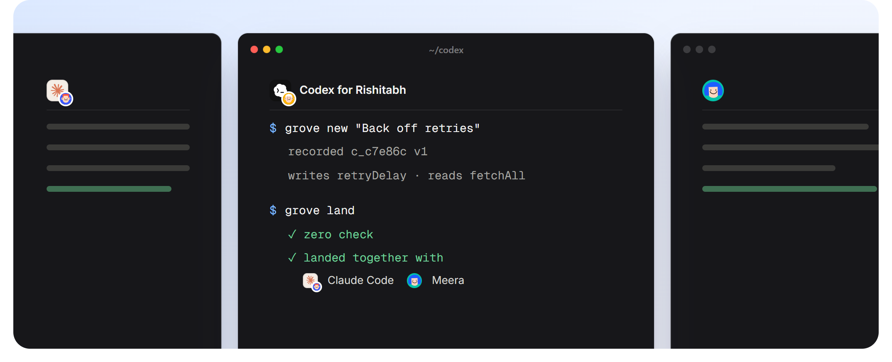

# Working together



## Everyone gets a workspace

```bash
grove workspace add claude ../claude --as agent:claude-code --for harshit
grove workspace add codex  ../codex  --as agent:codex       --for rishitabh
grove workspace add meera  ../meera  --as meera
grove workspace list
```

A workspace is a folder holding main, plus who works in it. People and agents never share one. Inside a workspace, every command acts as its owner unless you say otherwise (`--as`, `--for`, or `GROVE_AS` and `GROVE_FOR`).

## People and agents

An agent always acts **for** a person. Every change records both, `grove log` and `grove why` show both, and the git export carries both (`Grove-Agent`, `Grove-For`). It's always clear who asked for what.

## The loop

```bash
grove sync                 # start from today's main; your unrecorded edits are kept
# ...edit...
grove status               # what changed, by declaration
grove diff                 # the text diff
grove new "Back off retries"
grove land
```

After a change lands, its workspace moves to the new main by itself.

## What landing tells you

| Result | Means |
|---|---|
| `Landed ... (direct)` | Nothing else landed since you started |
| `Landed ... (together with ...)` | Others landed meanwhile, in other parts of the graph |
| `Landed ... (ordered after ...)` | Others changed something yours depends on; yours was replayed on top and checked again |
| `merged inside <name>` | Someone else changed the same function, on different lines: merged |
| `Did not land: a check failed` | The combined result failed a check; main didn't move. Fix it, `grove new`, `grove land` |
| `Did not land: it clashes` | Someone set the same lines differently. See [Reviews and conflicts](review-and-conflicts.md) |

## Signed, and reviewed by people

Every person and agent can sign their changes:

```bash
grove key new        # a key for whoever is acting, kept in ~/.grove/keys
grove key trust      # this repository trusts it
grove config review.require_signed true   # optional: refuse unsigned changes
```

Some changes should wait for a person. Turn on the rules a team wants:

```bash
grove config review.signature true        # a public function's signature changed
grove config review.capabilities true     # new file, network, process or HTTP access
grove config review.hot_links 10          # rewriting something 10+ things depend on
grove config review.protected billing,secrets
```

A change that hits a rule doesn't land until a person approves its current version. An agent can't approve, and nobody approves their own change. The person an agent worked for can approve the agent's change. Approvals are signed with the approver's key. With `review.require_signed` on, only approvals signed by a key this repository trusts for that person count; without it, an approval is taken on trust, so turn it on wherever people and agents share a machine.

For example:

```text
$ grove land
Did not land c_ac3106 "Strict parsing": it needs a person's approval first (`grove approve c_ac3106`).
  FAIL review: needs a person
       public signature of parse changed
$ grove approve c_ac3106 --as rishitabh
$ grove land
Landed c_ac3106 "Strict parsing" (direct)
  ok   signature: trusted key a643bcdcbc9f
  ok   review: approved by rishitabh (public signature of parse changed)
```

## Who's working on what

```bash
grove who
```

```text
codex        codex for rishitabh        c_ac3106 "Strict parsing" writes parse
meera        meera                      2 unrecorded edit(s)
default      harshit                    idle
```

## Longer work: lanes

```bash
grove lane new checkout-v2
grove lane use checkout-v2      # this workspace now lands on the lane
# ...several changes, each landed on the lane...
grove lane use main
grove lane land checkout-v2     # the lane's work lands on main as one change
```

## Across machines

Push and pull through a GroveHub server or another folder ([Remotes](remotes.md)), or through any git host ([Git](git.md)).
